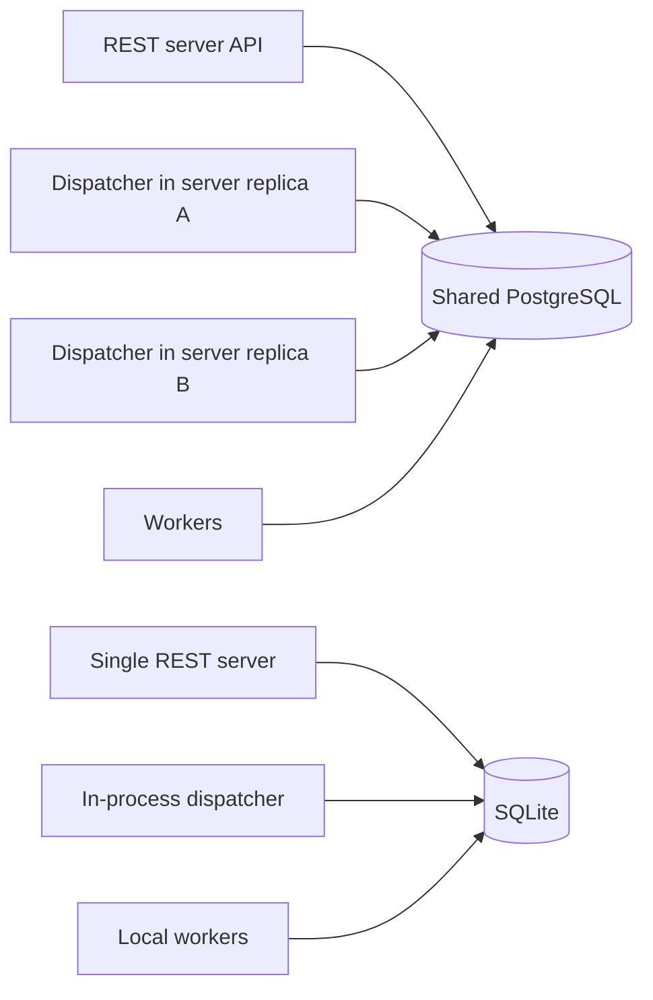

# REST job API and lifecycle contract

## Status and product boundary

This contract records both current implementation and target direction for Factory's single REST job-service MVP. Factory has a local REST server with authenticated bounded admission, selectable volatile-memory, SQLite, or PostgreSQL persistence, isolated workspaces, the configured multi-stage workflow, and optional GitHub pull-request publication. Current implementation details are in the [REST server feature guide](../features/rest-server.md), [configuration guide](../features/rest-server-config.md), and [operations guide](../features/rest-server-operations.md). Requirements explicitly identified as target or not implemented/verified remain proposals.

The product path is one service and one lifecycle:

**HTTP request → job admission → execution → verification → create/update PR → inspectable result**

Opening or updating a PR through the configured code-repository provider is required for a successful implementation job. Merge, release, and deployment are out of scope. Agent success alone is not a correctness verdict.

## Persistence modes

- **Memory backend:** the simple local-development and test mode. Jobs, history, idempotency keys, and execution state are volatile and lost on process restart. The service must disclose this mode and must not imply durable acceptance.
- **SQLite backend:** optional local durable storage with persisted jobs, idempotency, lifecycle/history, provider references, and conservative restart classification. The runtime permits only one server process to own a configured SQLite database.
- **PostgreSQL backend:** optional durable storage with persisted job/attempt ownership and lease metadata. The control plane may run with workers disabled while separately launched PostgreSQL worker processes share the job store. `limits.workers` is enforced as one database-wide execution cap across all processes sharing PostgreSQL, and all participating configs (including control-plane configs) must agree on its value. All-in-one server workers remain the default; there is no fleet coordinator. A workers-disabled API control plane cannot perform provider observation because it has no worker workspace or lookup executor callback; shared storage alone does not fix this, so operators must investigate and retain artifacts. Memory/SQLite concurrency caps are process-local. Neither durable backend persists workflow execution checkpoints or promises resumption within a running workflow.
- When SQL is explicitly configured and unavailable or unhealthy, admission fails closed; the server must not silently fall back to memory. Deployments requiring restart durability must use SQL or another explicitly supported durable backend.

All three backends implement the same admission and lifecycle contract. Tests should exercise shared behavior against memory and SQL. Recovery disposition is conservative: queued jobs have not been claimed and may resume; jobs found running at restart require explicit operator handling and must not be automatically replayed because workflow/provider side effects may have occurred; terminal jobs are retained for inspection; unknown states require operator investigation. This classification is not a durable worker-ownership or checkpoint mechanism. SQLite and PostgreSQL storage expose authenticated bodyless `POST /v1/jobs/{id}/disposition/{failed|canceled}` routes only for jobs this store instance classified as interrupted while running and only when no provider attempt or outcome is persisted; these actions record only the chosen failed/canceled state and fixed bounded audit event, retain verification evidence, and cannot accept caller evidence or success. Repeated identical dispositions are idempotent at the store transition level, though the HTTP route rejects a second request after the recovery-needed classification is cleared. The authenticated bodyless `POST /v1/jobs/{id}/reconcile` route accepts interrupted-running SQLite/PostgreSQL jobs and existing failed SQLite/PostgreSQL jobs only with a persisted provider attempt and retained workspace. It is unavailable from a PostgreSQL workers-disabled API control plane because the lookup requires the worker-local executor and workspace; sharing storage alone cannot perform it. On a worker-enabled runtime it verifies the configured checkout and retained branch/commit, then performs a read-only configured-provider lookup. An exact matching open PR is stored separately as `provider_observed` with one bounded audit event; it never records success or a provider outcome because the original write may still complete. No harness, verification, branch push, or provider write is replayed. Missing, mismatched, ambiguous, malformed, unavailable provider state or failed persistence leaves interrupted work `running` (or an existing failed job `failed`) and requires operator investigation. Memory storage rejects these startup recovery actions because it has no durable interrupted-job classification. Neither action provides worker leases, checkpoints, or automatic running-job recovery.

## Request and API

The current route shape is the target unless a reviewed contract change supersedes it:

- `GET /healthz` and `GET /readyz` are minimal unauthenticated probes.
- `POST /v1/jobs` submits a standalone bounded Job for a configured repository alias and task; optional issue context is not a separate job lifecycle. Scheduled Jobs also remain standalone and outside Thread membership. Authenticated `POST /v1/threads` creates one direct-request Thread and its initial Job atomically; Thread retries use a separate principal-scoped idempotency namespace, and distinct keys create distinct Threads. Authenticated `GET /v1/threads/{id}` returns stable member Jobs with status derived from their authoritative lifecycle and recovery state; `POST /v1/threads/{id}/jobs` atomically appends an ordered direct-request Job with a Thread-scoped idempotency key; bodyless `POST /v1/threads/{id}/complete` explicitly closes an owned Thread independent of aggregate status, recording `completed_at` and `completed_by` without mutating Jobs. Status-derived Done does not itself close a Thread. Completion is idempotent and serialized with member admission; new member admission after closure is rejected while an exact retry of a prior admission remains a replay. Operators can inspect any Thread but can append or complete only their own; submitters can inspect, append, or complete only their own, and missing/foreign IDs are non-disclosing 404. The routes accept repository/task only for admission and do not implement webhook/provider ingress. The implemented `GET /v1/notifications` exposes a durable authenticated in-product owner inbox (recipient is Thread.submitter), not an external delivery provider; one logical notification is committed atomically when an unclosed Thread transitions to Done. Reads do not emit, acknowledge, or mutate state, and a later Done cycle after member admission produces a new row. Notifications expose only bounded identity/status/timestamp fields and use bounded pagination/retention. See the [Thread model contract](thread-model.md). The implemented `factory issue-poller` submits eligible issue snapshots to the same canonical PostgreSQL Store. Confirmed `factory rest issue` dispatch re-fetches a versioned GitHub issue snapshot, requires explicit matching `--confirm-version`, and sends its exact generated task as ordinary `request.task` (visible through authenticated job detail), plus numeric `issue` and optional bounded `issue_provenance` identity metadata. The provenance object contains only tracker, source repository, issue number, SHA-256 version, matching issue URL, and sanitized title—never a duplicate issue body. The server does not authenticate this caller-supplied snapshot against GitHub. `(tracker, source_repository, issue_number, version)` maps uniquely to one retained job independent of idempotency key: exact complete requests replay the original job and attach the supplied key; differences conflict with sanitized HTTP 409. The client submits a changed-version identity only after explicit confirmation and a matching second fetch; the API does not authenticate that client-side confirmation or verify the snapshot against GitHub.
- `GET /v1/jobs` is role-dependent. The legacy shared API key and named operator credentials receive the existing bounded operator page of retained summaries (ID, status, timestamps), ordered oldest-first by immutable admission sequence with `snapshot_sequence` and `next_sequence`; later admissions cannot shift that traversal, while lifecycle values remain current per page. Named submitter credentials receive only their own bounded summaries in `{jobs,has_more,next_cursor}` and use a server-issued opaque `cursor` rather than numeric sequence values. Submitter cursor state is process-memory, principal-bound, expires after 15 minutes, and is invalidated on restart; operator pagination is unchanged. Both shapes omit task/payload text, provider information, events, logs, and paths. The CLI exposes the submitter contract via `factory rest list --mine [--cursor <opaque>]` and leaves the operator command as the default.
- `GET /v1/jobs/{id}` returns a retained job snapshot, including its submitted request. The additive `GET /v1/jobs/{id}/issue-provenance` returns only the job ID and bounded provenance metadata, never request/task text; it returns 404 if provenance is absent. Operators can inspect any retained job; submitters can inspect only their own jobs. The CLI exposes this projection as `factory rest issue-provenance [--json] <job-id>`.
- `GET /v1/jobs/{id}/history` returns bounded lifecycle events and a truncation indicator.
- Implemented in OpenAPI v1.5.0, authenticated read-only `GET /v1/jobs/{id}/events` streams curated lifecycle types and timestamps for one retained job as Server-Sent Events. Decimal per-job sequence IDs and `Last-Event-ID` support replay of newer retained events; expired cursors return `409 cursor_expired` before streaming or an in-stream `reset` frame if retention advances during a connection. Clients reconcile with `GET` status/history; after a `409 cursor_expired`, reconnect without a cursor, and after an in-stream `reset`, reconcile before reconnecting without the expired cursor. The stream polls retained bounded history (250 ms), admits at most 16 concurrent connections, heartbeats at 15 seconds, expires at 25 seconds, and applies a two-second write deadline. It exposes no messages, requests, provider data, logs, secrets, or paths; polling remains the fallback.
- `POST /v1/jobs/{id}/cancel` is a bodyless bearer-authenticated per-job cooperative cancellation request. A queued job is atomically canceled before claim and returns `200` with its terminal snapshot. A running job remains `running`, records one bounded `cancel_requested` history event, and returns `202` with `cancellation_requested: true`; the executor receives cancellation only for that job. Repeats while pending return `202` with the same state and no duplicate event. Once the worker exits, it records the terminal event/status and returns to `GET` as `canceled` only when no provider write may have occurred; if provider side effects are possible, it remains failed/inspectable for operator reconciliation rather than manufacturing a canceled or successful result. Terminal or otherwise ineligible jobs return sanitized `409 job_not_cancelable` without mutation. Cancellation does not delete workspaces or close/update/merge PRs.
- `GET /v1/jobs/{id}/provider-recovery` is a read-only operator-only projection of provider-attempt identity and optional stored read-only observation. It requires an existing job and a valid attempt in a store exposing the combined read API; missing/unsupported/malformed recovery data returns a sanitized conflict, operational store-read failures return a sanitized 503, and submitters receive non-disclosing 404. Memory mode exposes the in-memory attempt while it remains in the store; this view is volatile across eviction and restart. The response contains only provider, repository, branch, commit, generation, uncertain flag, and optional observation PR number/state/time. It never exposes a provider URL, paths, credentials, task text, or raw errors. Its explicit `provider_outcome_unresolved` status does not claim the original write has stopped. The route does not call providers, write state, or transition the job.
- `POST /v1/jobs/{id}/reconcile` is a bodyless bearer-authenticated operator action for startup-interrupted SQLite/PostgreSQL-running or terminal failed SQLite/PostgreSQL jobs with a persisted provider attempt and retained workspace. A configured read-only lookup that exactly matches the persisted repository, job branch, commit, base branch, and Factory job identity atomically records a separate provider observation and audit event. It never records a provider outcome or marks the job successful: the prior write may still be in flight, so the job remains unresolved and the route returns a sanitized conflict. An identical repeat does not add another observation; a conflicting repeat is rejected. No harness or provider write is run. Ineligible, mismatched, unavailable, or unpersistable state remains unresolved; no caller-selected PR identity is accepted.
- `POST /v1/jobs/{id}/disposition/failed` and `/canceled` are bodyless bearer-authenticated actions only for SQLite/PostgreSQL jobs this store instance classified as interrupted while running and with no persisted provider attempt/outcome. They atomically record only the selected failed/canceled disposition and a fixed bounded audit event, retaining prior evidence. No caller-supplied evidence or success disposition is accepted; memory, stale, or ineligible jobs conflict. Identical repeats are idempotent in the store, but the HTTP recovery-needed check rejects the route after a first successful disposition.
- Current schedule routes are `GET/POST /v1/schedules`, `GET/PATCH/DELETE /v1/schedules/{id}`, `GET /v1/schedules/{id}/history`, and `GET /v1/schedules/{id}/runs`. Submitters create and self-manage their schedules; named operator principals may also create schedules, owned by their own principal ID, and have operator-wide list/get/mutate access. The legacy shared operator credential retains list/get/mutate access but cannot create schedules. Creation records the caller as owner, immutable creator, and audit actor, and dispatched Jobs remain attributed to that owner. The original creator attribution remains immutable after operator changes. Schedule history is an append-only metadata-only audit of successful create/update/pause/resume/remove actions, with schedule ID, creator, actor, resulting revision, and timestamp. It contains no definition snapshots and has no global feed. Pages default to 50 entries, accept a maximum of 100, and use ascending `after_revision` continuation without deleting retained audit rows. For schedules that existed before the audit migration, history starts empty because the original create actor cannot be reconstructed; only actions committed after upgrade are recorded. Idempotency replays, failed/stale mutations, and dispatcher cursor changes do not emit entries. Submitters can read history only for their own schedules; operators can read any. Foreign/unknown submitter IDs are indistinguishable 404s. SQLite/PostgreSQL persistence is required; in-memory access returns `503 durable_store_required`. Definitions accept only cron, repository alias, and task. Cron is exactly five fields in UTC, with DOM/DOW OR behavior when both are restricted, minute-level minimum recurrence, and the first run at the next matching UTC minute strictly after create/edit/resume. Create uses principal-scoped idempotency. Strong revision ETags guard all mutations; stale values return `409 revision_conflict`. Removed definitions remain tombstones, IDs are not reused, and mutations do not change already admitted Jobs. There is no per-owner schedule cap. A bounded SQL dispatcher creates standalone Jobs atomically with their occurrence identities, or retains the oldest occurrence when capacity is full. Dispatch polls in bounded batches, retries durable failures, and resumes cursor/pending state after restart. Schedule run listing returns a bounded newest-first page of admitted, retained canonical Jobs with UTC occurrence, Job ID/status/timestamps, and a relative canonical Job detail link; it never repeats task text. SQL stores maintain an explicit schedule-run mapping with schedule ID, occurrence time, schedule revision, and canonical Job ID. Dispatch writes this mapping atomically with the Job and schedule cursor; migrations do not infer historical mappings from idempotency keys. Listing joins the mapping to retained canonical Jobs, so forged or historical matching keys alone are not provenance. Only admitted Jobs whose canonical records remain retained are listed; pending and skipped occurrences are not runs. `limit` defaults to 50 and is capped at 100; `before_sequence` continues older records by immutable admission sequence. The existing `pending_occurrence_at` and compact `skipped_occurrences` summary are exposed on schedule get/list responses as dispatch capacity state, not as a next-run projection. Pausing, editing, or removing a definition does not cancel or alter already admitted Jobs. There are no next-run projections, outcome/routing policy, overlap handling, notifications, or per-owner schedule cap.
- `GET /v1/operations` returns bearer-authenticated aggregate counts and capacity indicators only; it never returns job IDs, request payloads, events, provider details, or credentials.

An optional current implementation worker-identity listener is isolated from the job API and can be enabled only with SQLite/PostgreSQL persistence. It requires mTLS client-chain validation, checks the presented leaf certificate's `NotBefore`/`NotAfter` validity window and operator-configured maximum validity span on every authenticated worker-listener request before mapping lookup or session/capability access, and derives a stable principal from an exact configured client-leaf DER SHA-256 fingerprint; expired or not-yet-valid leaves receive the generic unauthenticated response. It supports durable session registration, same-boot capability rotation, and explicit retirement, with one active session per principal, permanently terminal principal/boot pairs, and append-only SQL registration/retirement audit. Registration returns a random 256-bit bearer capability that expires after 15 minutes; only its SHA-256 digest and expiry are stored, same-boot retry replaces it and invalidates the prior capability, and session retirement invalidates it. Capability-authenticated `GET /v1/worker/session` and `DELETE /v1/worker/session` derive the caller's session from the capability and do not accept a session ID; both require the valid bearer and an mTLS certificate mapped to the same principal. Missing or invalidated capabilities return generic `401 unauthenticated`; other authentication or store errors return sanitized `503 service_unavailable`. The pre-existing `DELETE /v1/worker/session/{session_id}` route remains mTLS-authenticated and returns `404 not_found` for a missing session, `400 invalid_request` for malformed input, `409 session_conflict` only for an explicit session conflict, and sanitized `503` for busy or other store errors. Capability issuance and rotation are atomically audited with the digest and expiry update, without storing the raw capability. This does not yet expose worker claims, ownership, job execution, reassignment, replay, or revocation, and is distinct from the future worker attempt protocol described by [worker identity and credential contract](worker-identity-credential-contract.md), which remains incomplete. All job routes require bearer authentication, with named-principal role/ownership filtering as described above. The legacy shared key is operator-wide. Requests cannot select arbitrary filesystem paths, executables, shell text, or verification commands. The server owns repository/provider configuration and enforces request, task, concurrency, time, history, and output bounds. Preserve strict JSON validation, safe generic errors, secret/path redaction, exact route/method behavior, and the current loopback listener default.

Use a client-supplied `Idempotency-Key`. Named-principal idempotency keys are scoped to the authenticated principal, so identical key text used by different principals does not collide; within a principal, an identical retry maps to the same job and reuse with a different normalized payload conflicts. Issue-provenance tuple uniqueness remains global across principals and idempotency keys. A tuple already reserved by another principal/job returns a generic sanitized conflict that does not disclose the existing owner or job. A same-principal exact provenance replay can attach an additional scoped key while the record is retained. New job snapshots include `submitted_by`; the SQLite migration backfills pre-existing jobs/keys to `legacy-shared`, because the old shared bearer key cannot identify individual historical submitters. `legacy-shared` is a shared-key attribution, not evidence of which individual submitted the record. Current strict config requires at least one enabled named operator while preserving the shared key as operator authority; migration and config upgrade should be deployed together. For issue provenance, the independent tuple uniqueness is retained for as long as the job record remains: memory eviction removes the corresponding provenance mapping, and SQLite refuses record eviction at its configured cap, retaining the mapping with the record. In memory mode these guarantees last only while the process and record remain. SQLite idempotency keys and provenance uniqueness are transactionally durable across restart and independent connections.

## Job lifecycle and provider operations

A job is not successful until Factory has:

1. admitted and recorded the request according to the selected persistence mode;
2. executed the configured requirements/implementation/review/documentation workflow in a job-specific workspace; implementation remains serial by default, with optional `parallel_subtasks.enabled` selecting the existing planner-driven parallel implementation within a job (default subtask concurrency 4, explicit range 1–8). This per-job concurrency is separate from `limits.workers`, the concurrent-job limit. The established planner validation, declared-scope, dependency-wave, integration, and rollback machinery must be reused; it is not a security sandbox, and operators remain responsible for trusting repositories and harness content;
3. run configured verification checks and recorded results/limitations;
4. created or updated the job's PR through the configured code-repository provider; and
5. persisted the confirmed provider outcome and PR identity/URL.

The inspectable job outcome includes bounded structured verification evidence and explicit limitations. Expose safe check labels and outcomes, not caller-accessible commands, output, transcripts, or host paths. When no external checks are configured, record that limitation; agent-reported workflow completion is not an independent correctness verdict.

The repository-provider interface is independent of issue-tracker integrations. The initial provider choice is configuration, not embedded in the canonical job model. Provider implementations must support scoped repository identity, branch and PR lookup/create/update, and enough stable identifiers to reconcile retries. Credentials are operator-configured, least-privilege, excluded from task prompts, records, logs, and API responses, and passed only to the operations that need them.

Treat timeouts, disconnects, and restarts around branch/PR writes as uncertain outcomes. The current immediate GitHub publisher retains its pre-write lookup, but after a create/update write is dispatched any failed or unverifiable response (transport loss, interruption, non-2xx, malformed response, or identity mismatch) returns `ErrUncertain` without a post-write lookup or retry. Do not blindly create another branch or PR; preserve the workspace and expose a failed/needs-operator outcome rather than success. A read-only matching lookup records a separate observation atomically with its bounded audit event, but cannot establish that the original write has stopped. The job remains failed or recovery-needed and no provider outcome is recorded; identical repeats are idempotent and conflicting repeats are rejected. No harness replay or provider write occurs.

Cancellation is cooperative and job-scoped; it is distinct from whole-server shutdown and SQLite restart recovery. Queued cancellation must prevent claim/execution; running cancellation must not terminalize until the worker exits. A cancellation request records that it was requested, while terminal outcome accounts for whether a provider attempt/outcome may have completed. Ambiguous provider writes remain failed/inspectable with retained workspace for eligible read-only provider observation, never fabricated as canceled or successful. A cancellation or issue closure must not silently delete workspaces or close/merge a PR. Ambiguous or over-policy scope pauses for human direction. Factory never merges, releases, or deploys.

## Security and trust

The service accepts work that executes agent and repository-controlled content with the server account's local-process authority. A local process, Nix shell, or container is not a security sandbox. Optional parallel subtasks add concurrent local agent processes within a job; this is separately bounded from concurrent REST jobs, and the planner/scope/rollback controls do not alter the trust boundary or isolate the harness from server-account authority. Define the trust boundary for API-key holders, repository allowlists, provider credentials, network exposure, and untrusted issue/repository/PR content. The API key must not be passed to the harness. Keep external text and generated output as untrusted data; it cannot override user scope, policy, or credential boundaries.

Expose sanitized status/history rather than raw agent transcripts or host paths. Bound subprocess output while continuing to drain child pipes after the capture limit. Do not describe limits as RSS guarantees unless actually enforced at the OS/container level.

## Current runtime and implementation gates

The `factory server` supports memory mode; SQLite and PostgreSQL persistence and the GitHub provider are configuration-gated features. PostgreSQL can be shared by a workers-disabled API control plane and separately launched `factory worker` processes, with `limits.workers` acting as a global database-wide execution cap that must match across all configs. Memory/SQLite worker caps are process-local. Provider observation is unavailable in the workers-disabled control plane because it does not hold worker workspaces or lookup executor callbacks; shared storage alone is insufficient, so operators must investigate and retain artifacts. The all-in-one server worker behavior remains the default; there is no fleet coordinator. Named principal authentication, operator/submitter role enforcement, `submitted_by`, global issue-provenance uniqueness with non-disclosing conflicts, principal-scoped idempotency, submitter-owned listing, and opaque submitter cursors are implemented on the current `feature/named-submitter-auth` work branch; they are not claims about older released server binaries. The CLI supports submitter listing and provenance-only inspection. Persistent schedules, bounded durable occurrence dispatch, and bounded admitted-run inspection are supported for named submitters and named operators on SQLite/PostgreSQL. Named operators create schedules in their own owner/idempotency namespace; legacy shared-key creation remains denied. The OpenAPI is version 1.17.0. A provider-configured job is successful only after its verified branch is pushed, the matching PR is created/updated, and that outcome is recorded in the selected store. See [REST job server](../features/rest-server.md) and [server configuration](../features/rest-server-config.md) for shipped behavior.

Delivery gates for the target MVP:

1. Define persistence interfaces and durable lifecycle semantics without changing the existing memory-mode API contract. (Implemented.)
2. Add optional SQLite persistence and migrations; fail closed when configured storage is unavailable; prove restart and concurrency behavior. (Implemented; SQLite concurrent same-key admission across independent store connections is tested, and the canonical PostgreSQL Store is runtime-selectable.)
3. Define/configure the code-repository provider interface and credential boundary. (Implemented.)
4. Implement idempotent branch/PR reconciliation, create/update, and durable recording of the confirmed result. (Partially implemented: initial lookup and validated 2xx create/update responses plus separate explicit read-only recovery exist; #261's immediate publish uncertainty remains incomplete because a live match does not establish that an earlier write has quiesced.)
5. Exercise end-to-end request-to-PR behavior including concurrent admission, process restart, duplicate requests, workflow/provider failure, cancellation, and durable outcome checks. (Core request-to-PR and concurrency path implemented; authenticated job inspection exposes bounded verification outcomes/limitations and confirmed PR identity; SQLite cross-connection admission, process-level shutdown cancellation, per-job cancellation, queued-job restart resumption with interrupted-running retention, and fake-provider lost-response/restart/explicit disposition and read-only provider observation for interrupted and failed jobs are tested. Merged PR #128 adds deterministic tests of the production GitHub adapter against GitHub REST-shaped `httptest` endpoints for an accepted create with a lost response, temporarily unavailable lookups, exact read-only reconciliation mapping, and zero duplicate writes. These tests do not establish live GitHub account/repository behavior; live validation remains unverified and owner-gated. Automatic reconciliation of interrupted running work remains unimplemented; worker leases/checkpoints and fleet ownership are not provided.)
6. Document memory-mode volatility, SQLite setup/recovery, backup/retention, security boundaries, and provider configuration. (Configuration and operations guides available; backup/restore command and count-only aggregate status are implemented. PR #131 adds backup/restore process E2E coverage but does not establish a production restore drill. The SQLite backup excludes separate workspaces. Merged PR #133 superseded #117 and adds startup logging of the selected persistence mode after listener readiness; it does not disclose the SQLite path or secrets.)

These are implementation gates, not claims of release dates. Completed steps describe merged behavior; remaining details above identify work not yet implemented or verified. Further issue reconciliation/provider events, additional hosting/fleet layers, merge, release, and deployment are not prerequisites for this MVP. The current client supports explicit opt-in preview and version-confirmed dispatch of one bounded REST job from a selected issue snapshot. The separate `factory issue-poller` process supports exact allowlisted trigger-label intake into the canonical PostgreSQL Store. The webhook and poller share a system-enforced PostgreSQL owner registry per exact source/label pair, with explicit operator registration and generation-fenced transfer; this does not coordinate different databases, older binaries, or GitHub-side quiescence. Each eligible source/version is admitted atomically as one Thread with one canonical Job, durable provenance, Thread-specific deterministic idempotency, and a bounded label-removal obligation; the retained provenance tuple is the dedupe authority, not the evictable label ledger. Exact retained poller Jobs attach to their proven source Thread without duplicate queue events; principal/request conflicts or unproven memberships fail closed. The poller has a database singleton guard and conservative label-removal retry. It does not add issue status to the REST job lifecycle, a second execution queue, or an HTTP/webhook endpoint. The client also supports explicit owner-filtered job listing with an opaque cursor for named submitters, in addition to the unchanged operator sequence-based listing. Bounded server-side provenance-to-job uniqueness is implemented for the scope described above; broader issue-intake design (#244)—including further reconciliation and additional provenance-aware workflow/inspection—is not claimed complete.

## Scheduled Job occurrence dispatch — target behavior for #338

Persistent schedule definitions are implemented by #333 in SQLite and PostgreSQL. This section defines the #338 dispatcher and its durable occurrence-admission behavior.

A dispatcher runs inside every REST server runtime. PostgreSQL replicas coordinate through the shared SQL store; SQLite remains single-server storage. The dispatcher is bounded and polls durable schedules. It creates exactly one standalone canonical Job for each admitted occurrence, with the schedule owner as submitter. Durable `factory_schedule_runs` provenance records `(schedule_id, occurrence_utc)`, `schedule_revision`, and the canonical Job ID; revision is recorded as provenance, while the primary key ensures an occurrence is admitted only once across revisions. The ordinary Job path supplies request validation, reserved-namespace idempotency, and event history. Scheduled Jobs do not join Threads.



On create, edit, or resume, the first matching UTC minute strictly after the write is the new cursor. Pause and remove deactivate future firings. Changes only affect future firings: an already committed occurrence is immutable. If a commit result is uncertain, the next poll reloads durable schedule state: a successful commit has advanced the cursor and persisted the Job together, while a rolled-back transaction leaves the original due cursor available for retry. A dispatch pass processes at most 32 schedules; each schedule occurrence has its own transaction so one slow schedule cannot hold locks for the entire batch.

The schedule row holds the next occurrence cursor, at most one oldest pending occurrence, and a compact skipped summary (`revision`, first UTC time, last UTC time, count). The summary is reset at revision change and bounded to one row per schedule. Occurrences missed while the dispatcher was down are skipped and recorded. If the oldest due occurrence cannot be admitted because the queue or retained-record capacity is full, it remains pending. Later due occurrences while it is pending are skipped and added to the summary; they are not queued as a backlog. When capacity returns, the oldest pending occurrence is attempted first, then the cursor resumes at the next future matching minute.

```mermaid
stateDiagram-v2
  [*] --> Future: cursor initialized after create/edit/resume
  Future --> Due: UTC cursor <= poll time
  Due --> Admitted: capacity available; Job + cursor commit
  Due --> Pending: ErrQueueFull or ErrRegistryFull
  Pending --> Pending: capacity still full; retain oldest, summarize later due times
  Pending --> Admitted: capacity returns; same occurrence identity
  Future --> Skipped: downtime passed matching minutes
  Skipped --> Future: update compact revision-scoped first/last/count
  Admitted --> Future: cursor set to next future match
  Pending --> Future: newer revision mutation cancels old pending state
```



Each schedule is handled in its own transaction. PostgreSQL acquires the global job-capacity advisory lock, then selects one due row with `FOR UPDATE SKIP LOCKED`; SQLite serializes the immediate write transaction. Only after obtaining the capacity lock does a PostgreSQL dispatcher read/lock the schedule row. All Job admission writers, including API admission and issue intake, use that same capacity lock. This fixed lock order avoids dispatch/API deadlocks while ensuring concurrent replicas cannot oversubscribe the shared queue or retained-record cap.

Atomicity requires job, principal-scoped idempotency identity, explicit schedule-run mapping, initial queued event, occurrence admission, cursor advance, pending state, and skipped summary to commit together. PostgreSQL takes the global Job admission-capacity advisory lock first, then locks one due schedule row and confirms its revision. All admission writers use that same capacity lock. SQLite uses a serialized immediate write transaction. If mutation commits first, the old revision is excluded. If dispatch commits first, that occurrence may commit before the mutation; it is not rewritten. Workers see only complete canonical Jobs.

```mermaid
sequenceDiagram
  participant D as Dispatcher
  participant DB as SQL Store
  participant M as Schedule mutation
  D->>DB: Begin transaction
  D->>DB: Lock global Job-capacity gate (PostgreSQL)
  D->>DB: Lock due schedule row and read revision/cursor
  D->>DB: Check normal queue and retained-record capacity
  alt capacity available
    D->>DB: Insert canonical Job + identity + queued event
    D->>DB: Advance cursor and summarize skipped due times
  else ErrQueueFull or ErrRegistryFull
    D->>DB: Retain oldest pending occurrence and summarize later due times
  end
  D->>DB: Commit all occurrence state atomically
  Note over D,DB: On storage error, the next poll reloads durable schedule state; atomic commit keeps Job and cursor together
  M->>DB: Revision mutation serializes on schedule row
  Note over M,DB: Mutation-first excludes old revision; dispatch-first can admit only its committed occurrence
```

A storage error causes the next poll to reload durable schedule state. Because Job admission and cursor/pending updates commit in one transaction, a successful commit leaves both the Job and advanced schedule state visible; a rolled-back transaction leaves the original due cursor available for retry. There is no separate occurrence-key lookup or reconciliation after an uncertain commit. The runtime uses bounded poll intervals, logs only a fixed sanitized retry message, retries durable state with backoff, and stops the dispatcher during shutdown. The exact queue errors `ErrQueueFull` and `ErrRegistryFull` are capacity outcomes that preserve pending state; other storage or transaction errors cannot partially persist the Job and schedule changes.

Dependencies: #338 requires #333's persisted, revisioned schedule rows and canonical Job Store. Deferred decisions: overlap/outcome policy (#339), notifications, schedule UI, next-run projection, alternate queues, per-owner schedule caps, and changes to execution safety. The dispatcher does not add these policies.

## REST configuration reference

[The server configuration guide](../features/rest-server-config.md) describes the implemented schema and [operations guide](../features/rest-server-operations.md) covers current readiness and recovery guidance. Provider credential mechanisms beyond the configured GitHub token-file flow are outside the current implementation.